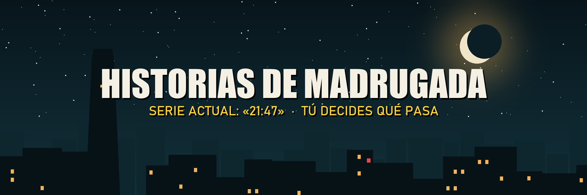

# Historias de Madrugada



🔗 [Instagram @historias.d.madrugada](https://instagram.com/historias.d.madrugada) · [TikTok @historias.d.madrugada](https://www.tiktok.com/@historias.d.madrugada)

Página de apoyo del proyecto **Historias de Madrugada**, una serie de historias animadas producida con **HyperFrames** (video generado desde HTML) y **Claude**.

## Resultados
- **+3 millones** de visualizaciones en el perfil
- **+10.000 seguidores** en una semana

## Cómo se hace
Cada episodio es animación 100 % generada por código, con un pipeline propio en Python desarrollado junto a Claude:

```
guion → voces → timing.json → escenas SVG + GSAP + sonido → gen.py → HyperFrames → MP4 → Drive
```

1. **Guion:** líneas, qué se ve en cada plano y la encuesta del episodio.
2. **Voces:** `voces.py` genera la voz de cada personaje con edge-tts (voces neuronales con tono y velocidad propios) o con Kokoro en local. Después ffmpeg aplica efectos: filtro de radio, eco, voces superpuestas y recorte de silencios.
3. **Tiempos y subtítulos:** `timing.py` mide cada audio y calcula la duración de cada plano y el momento exacto en que aparece cada palabra del subtítulo. Permite destacar palabras y mostrar números distinto a como se pronuncian.
4. **Animación:** los personajes son *rigs* en SVG dibujados con código, con poses reutilizables. GSAP anima el movimiento (caminar, cortes de cámara, parallax) y unos helpers propios agregan iluminación, sombras, grano y corrección de color.
5. **Sonido:** una lista de efectos sincronizados a la palabra. Mezcla sonidos sintetizados por código con grabaciones CC0 de Freesound normalizadas a −20 LUFS.
6. **Armado:** `build_gen.py` reúne los personajes y helpers de todas las partes en un generador de ~3.300 líneas, que produce el proyecto HyperFrames con un archivo HTML por plano.
7. **Render:** `hyperframes check` y snapshots para revisar cada cuadro. Luego se renderiza en un navegador headless a 1080×1920 y 30 fps, y ffmpeg genera una versión comprimida para publicar desde el celular.

## Stack
Python · JavaScript · SVG · GSAP · HyperFrames · edge-tts · Kokoro · ffmpeg · Claude
